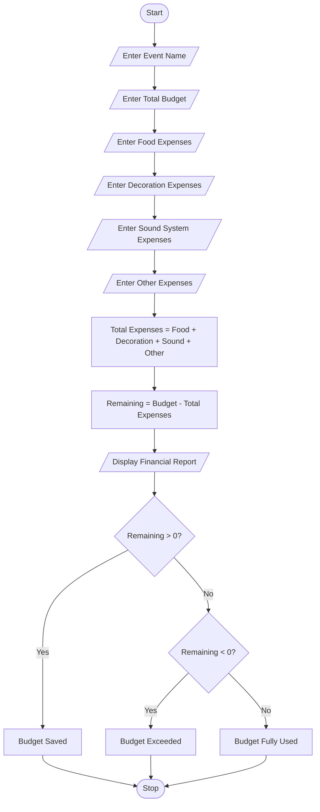

## Problem Statement
Develop a Python program to manage the financial planning of a campus event by calculating the total budget and expenses. The program should accept expenses for food, decoration, sound systems, and other activities. It should calculate the remaining amount and identify whether the budget is saved, exceeded, or fully used.

## Objectives
1. To accept campus event details.
2. To enter the total event budget.
3. To calculate expenses for food, decoration, sound systems, and other activities.
4. To calculate total expenses.
5. To find the remaining budget amount.
6. To identify whether the budget is saved, exceeded, or fully used.
7. To display the financial report clearly.
 
## Assumptions
1. Event name is entered by the user.
2. Total budget is entered in Indian Rupees.
3. Food, decoration, sound system, and other expenses are entered separately.
4. All expenses are considered in Indian Rupees.
5. No additional income or sponsorship amount is considered.
6. All entered expenses are valid positive amounts or zero.
7. The program uses the remaining budget to identify the financial status.
 
## Algorithm
1. Start the program.
2. Enter the event name.
3. Enter the total budget.
4. Enter food expenses.
5. Enter decoration expenses.
6. Enter sound system expenses.
7. Enter other expenses.
8. Calculate total expenses by adding all expenses.
9. Calculate remaining amount by subtracting total expenses from the budget.
10. Display event name, total budget, total expenses, and remaining amount.
11. If remaining amount is greater than zero, display Budget Saved.
12. If remaining amount is less than zero, display Budget Exceeded.
13. Otherwise, display Budget Fully Used.
14. Stop the program.

## Pseudocode
START

INPUT event_name

INPUT budget
INPUT food
INPUT decoration
INPUT sound
INPUT other

total_expenses = food + decoration + sound + other

remaining = budget - total_expenses

DISPLAY event_name
DISPLAY budget
DISPLAY total_expenses
DISPLAY remaining

IF remaining > 0 THEN
    DISPLAY "Budget Saved"

ELSE IF remaining < 0 THEN
    DISPLAY "Budget Exceeded"

ELSE
    DISPLAY "Budget Fully Used"

END IF

STOP

## Test Cases
```
  Test Case   |   	Budget   |   	Total Expenses    |   	Remaining   |  	Expected Status
      1	      |   ₹50,000	   |     ₹40,000	        |      ₹10,000	  |    Budget Saved
      2       |  	₹30,000	   |     ₹35,000          | 	  -₹5,000	    |    Budget Exceeded
      3       | 	₹40,000    |     ₹40,000	        |      ₹0         |    Budget Fully Used
      4       | 	₹60,000    |     ₹45,000          |      ₹15,000    |    Budget Saved
      5       | 	₹25,000    |     ₹28,000          |    	-₹3,000	    |    Budget Exceeded
```

## Output Screenshots
Enter event name: College Fest
Enter total budget: 50000
Enter food expenses: 15000
Enter decoration expenses: 10000
Enter sound system expenses: 8000
Enter other expenses: 7000

--- Campus Event Financial Report ---
Event Name: College Fest
Total Budget: Rs. 50000.0
Total Expenses: Rs. 40000.0
Remaining Amount: Rs. 10000.0
Status: Budget Saved
Enter event name: Tech Fest
Enter total budget: 30000
Enter food expenses: 12000
Enter decoration expenses: 8000
Enter sound system expenses: 9000
Enter other expenses: 6000

--- Campus Event Financial Report ---
Event Name: Tech Fest
Total Budget: Rs. 30000.0
Total Expenses: Rs. 35000.0
Remaining Amount: Rs. -5000.0
Status: Budget Exceeded
Enter event name: Annual Day
Enter total budget: 40000
Enter food expenses: 15000
Enter decoration expenses: 10000
Enter sound system expenses: 10000
Enter other expenses: 5000

--- Campus Event Financial Report ---
Event Name: Annual Day
Total Budget: Rs. 40000.0
Total Expenses: Rs. 40000.0
Remaining Amount: Rs. 0.0
Status: Budget Fully Used

 ## Conclusion
The Campus Event Financial Planning program successfully calculates the total expenses and remaining budget for a college event. It uses Python arithmetic operations and conditional statements to identify whether the budget is saved, exceeded, or fully used. This case study helps students understand budget management, financial calculations, and the practical applications of Python in campus event planning.

## Flowchart

