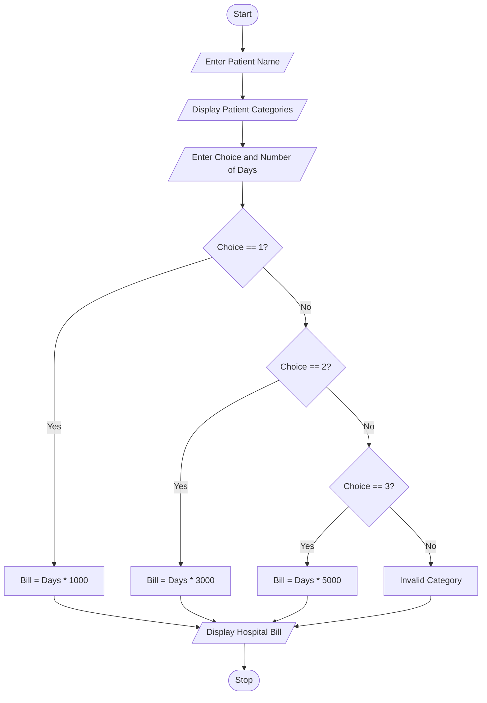

## Problem Statement
Develop a Python program to calculate hospital bills based on the patient's category and the number of days admitted to the hospital.

The program should accept the patient's name, category, and number of days. Based on the selected category, it calculates the total hospital bill using different charges.

Hospital billing rates:
Patient Category	Cost per day
General Patient	₹1,000
Emergency Patient	₹3,000
ICU Patient	₹5,000

The program should display the patient's details and total hospital bill.

## Objectives
1. To understand conditional statements in Python.
2. To classify patients into different categories.
3. To calculate hospital bills based on the number of days.
4. To use if, elif, and else statements.
5. To display patient details and billing information.
 
## Assumptions
1. Patient name is entered as a string.
2. Patient category is selected using numbers 1, 2, or 3.
3. Number of hospital days is entered as an integer.
4. General patients are charged ₹1,000 per day.
5. Emergency patients are charged ₹3,000 per day.
6. ICU patients are charged ₹5,000 per day.
7. No additional medical charges or taxes are included.
   
## Algorithm
1. Start the program.
2. Enter the patient's name.
3. Display the three patient categories.
4. Enter the patient category.
5. Enter the number of hospital days.
6. Check the selected category:
   - If choice is 1, calculate bill at ₹1,000 per day.
   - If choice is 2, calculate bill at ₹3,000 per day.
   - If choice is 3, calculate bill at ₹5,000 per day.
   - Otherwise, display Invalid Category.
7. Display patient name.
8. Display patient category.
9. Display number of days.
10. Display total hospital bill.
11. Stop the program.
    
## Pseudocode
START

INPUT patient_name

DISPLAY "1. General Patient"
DISPLAY "2. Emergency Patient"
DISPLAY "3. ICU Patient"

INPUT choice
INPUT days

IF choice == 1 THEN
    category = "General Patient"
    bill = days * 1000

ELSE IF choice == 2 THEN
    category = "Emergency Patient"
    bill = days * 3000

ELSE IF choice == 3 THEN
    category = "ICU Patient"
    bill = days * 5000

ELSE
    category = "Invalid Category"
    bill = 0

END IF

```
##  Test Cases

Testcase  |	  Category    |    Days   	|    Expected bill
   1	    |   General	    |      2	    |     ₹2,000
   2	    |   General	    |      5      |   	₹5,000
   3	    |   Emergency	  |      2	    |     ₹6,000
   4	    |   Emergency	  |      4	    |     ₹12,000
   5      |   	ICU	      |      2	    |     ₹10,000
   6	    |     ICU	      |      5	    |     ₹25,000
   7	    |    Invalid	  |      3	    |     ₹0

```

## Output Screenshots
Enter patient name: Usha
1. General Patient
2. Emergency Patient
3. ICU Patient
Enter patient category: 1
Enter number of days: 2

--- Hospital Bill ---
Patient Name: Usha
Patient Category: General Patient
Number of Days: 2
Total Bill: Rs. 2000
Enter patient name: Usha
Enter patient category: 2
Enter number of days: 3

--- Hospital Bill ---
Patient Name: Usha
Patient Category: Emergency Patient
Number of Days: 3
Total Bill: Rs. 9000
Enter patient name: Usha
Enter patient category: 3
Enter number of days: 2

--- Hospital Bill ---
Patient Name: Usha
Patient Category: ICU Patient
Number of Days: 2
Total Bill: Rs. 10000

## Conclusion
This case study explains how Python can be used to calculate hospital bills based on patient classification. The program uses conditional statements such as if, elif, and else to identify the patient category and calculate the charges. It helps beginners understand decision-making, user input, arithmetic operations, and output statements in Python. The program makes hospital billing simple and easy to understand.

## Flowchart



