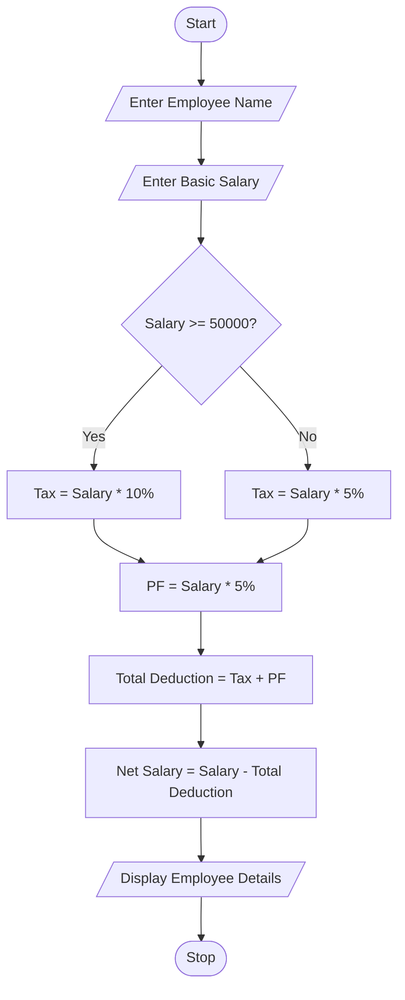

## Problem Statement
Develop a Python program to calculate the net salary of an employee based on their basic salary. The program should calculate tax, Provident Fund (PF), total deductions, and net salary using conditional statements.

## Objectives
1. To calculate the employee's salary.
2. To calculate tax based on basic salary.
3. To calculate Provident Fund (PF).
4. To find the total deductions.
5. To calculate the final net salary.
6. To display employee salary details clearly.
 
## Assumptions
1. Employee name is entered by the user.
2. Basic salary is entered in rupees.
3. If salary is ₹50,000 or above, tax is 10%.
4. If salary is below ₹50,000, tax is 5%.
5. PF is calculated at 5% of basic salary.
6. Net salary is calculated after deducting tax and PF.
 
## Algorithm
1. Start the program.
2. Read employee name.
3. Read basic salary.
4. Check whether salary is greater than or equal to ₹50,000.
5. If true, calculate tax at 10%.
6. Otherwise, calculate tax at 5%.
7. Calculate PF at 5%.
8. Calculate total deductions (Tax + PF).
9. Calculate net salary (Basic Salary − Total Deductions).
10. Display all employee salary details.
11. Stop the program.

## Pseudocode
START

INPUT employee_name
INPUT basic_salary

IF basic_salary >= 50000 THEN
    tax = basic_salary * 0.10
ELSE
    tax = basic_salary * 0.05
END IF

pf = basic_salary * 0.05

total_deduction = tax + pf

net_salary = basic_salary - total_deduction

DISPLAY employee_name
DISPLAY basic_salary
DISPLAY tax
DISPLAY pf
DISPLAY total_deduction
DISPLAY net_salary

STOP

```
## Test Cases
   Testcase   |  	Employee name  |  	Basic salary    |  	Expected net salary
      1       |     	Ravi        |    	₹60,000	      |       ₹51,000
      2	      |       Sita	      |      ₹40,000      |       ₹36,000
      3	      |       Kumar	     |      ₹50,000	     |       ₹42,500
      4	      |       Priya	     |      ₹30,000      |       ₹28,500

```
## Output Screenshots
Enter employee name: Ravi
Enter basic salary: 60000
Enter employee name: Sita
Enter basic salary: 40000

--- Employee Salary Details ---
Employee Name: Sita
Basic Salary: Rs. 40000.0
Tax: Rs. 2000.0
PF: Rs. 2000.0
Total Deduction: Rs. 4000.0
Net Salary: Rs. 36000.0

## Conclusion
The Employee Payroll and Deduction Analysis program successfully calculates an employee's net salary using Python. It uses conditional statements to calculate tax, arithmetic operations to calculate PF and total deductions, and displays the final salary details. This case study helps students understand the practical application of Python programming in employee payroll management.
--- Employee Salary Details ---
Employee Name: Ravi
Basic Salary: Rs. 60000.0
Tax: Rs. 6000.0
PF: Rs. 3000.0
Total Deduction: Rs. 9000.0
Net Salary: Rs. 51000.0

## Flowchart

