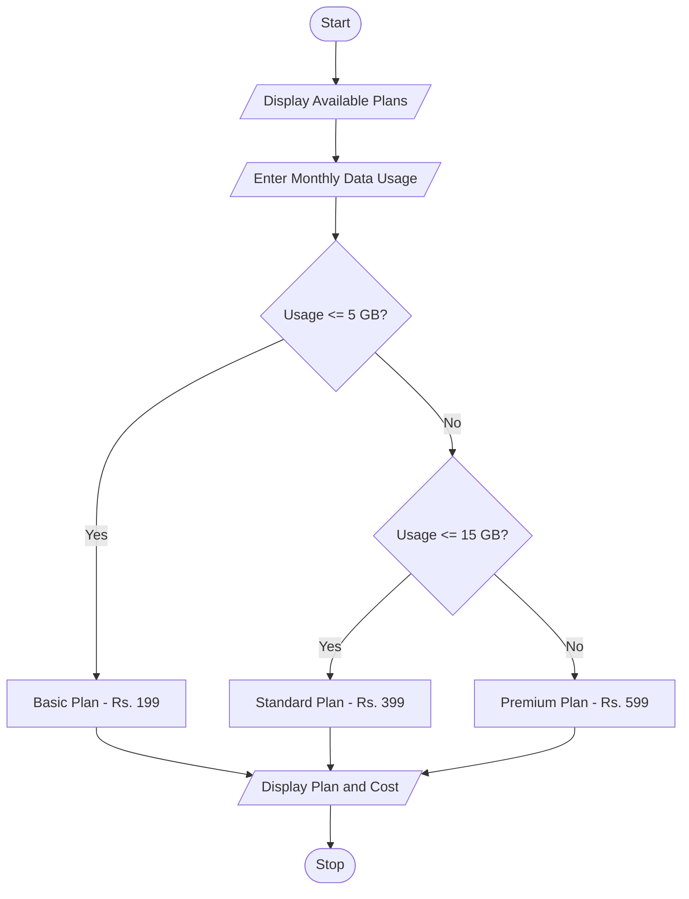

## Problem Statement
Develop a Python program to select the best mobile data plan based on the customer's monthly data usage. The program should identify the suitable plan (Basic, Standard, or Premium) and display the selected plan and its monthly cost.

## Objectives
1. To understand different mobile data plans.
2. To accept monthly data usage from the user.
3. To select a suitable plan using conditional statements.
4. To calculate the monthly plan cost.
5. To display the selected plan and total cost.
   
## Assumptions
1. Monthly data usage is entered in GB.
2. Basic Plan costs ₹199 for usage up to 5 GB.
3. Standard Plan costs ₹399 for usage above 5 GB and up to 15 GB.
4. Premium Plan costs ₹599 for usage above 15 GB.
5. The program considers only monthly data usage.
6. All prices are fixed.
 
## Algorithm
1. Start the program.
2. Display the available mobile data plans.
3. Enter monthly data usage in GB.
4. Check whether usage is less than or equal to 5 GB.
5. If true, select Basic Plan with ₹199.
6. Otherwise, check whether usage is less than or equal to 15 GB.
7. If true, select Standard Plan with ₹399.
8. Otherwise, select Premium Plan with ₹599.
9. Display the selected plan, monthly usage, and total cost.
10. Stop the program.
 
## Pseudocode
START

DISPLAY Basic Plan - Rs.199
DISPLAY Standard Plan - Rs.399
DISPLAY Premium Plan - Rs.599

INPUT usage

IF usage <= 5 THEN
    plan = "Basic Plan"
    cost = 199

ELSE IF usage <= 15 THEN
    plan = "Standard Plan"
    cost = 399

ELSE
    plan = "Premium Plan"
    cost = 599

END IF

DISPLAY plan
DISPLAY usage
DISPLAY cost

STOP

```## Test Cases
 Test Case  |  	Data Usage	|    Selected Plan  	|   Total Cost
    1	      |     3 GB	    |      Basic Plan	    |    ₹199
    2	      |     5 GB	    |      Basic Plan	    |    ₹199
    3       |    	10 GB     |   	Standard Plan	  |    ₹399
    4       |   	15 GB	    |     Standard Plan	  |    ₹399
    5	      |     20 GB     |    	Premium Plan	  |    ₹599
```

## Output Screenshots
1. Basic Plan - Rs. 199
2. Standard Plan - Rs. 399
3. Premium Plan - Rs. 599

Enter monthly data usage in GB: 3

--- Best Plan Details ---
Selected Plan: Basic Plan
Monthly Usage: 3 GB
Total Cost: Rs. 199
Enter monthly data usage in GB: 10

--- Best Plan Details ---
Selected Plan: Standard Plan
Monthly Usage: 10 GB
Total Cost: Rs. 399
Enter monthly data usage in GB: 20

--- Best Plan Details ---
Selected Plan: Premium Plan

## Flowchart

