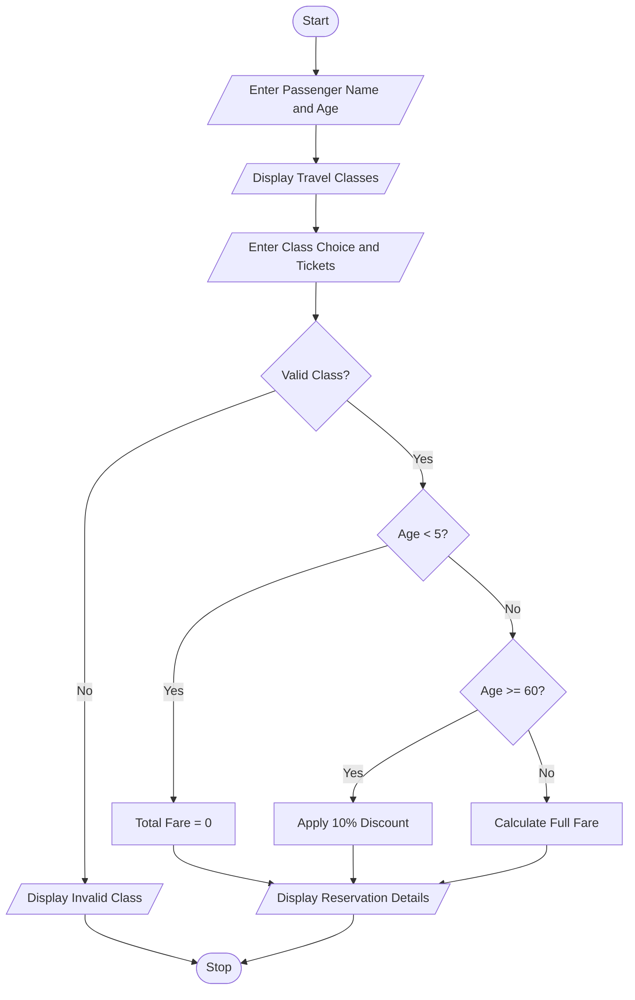

## Problem Statement
Develop a Python program to calculate railway ticket fares based on passenger age, travel class, and number of tickets. The program should provide different ticket prices for Sleeper, AC, and First Class. It should also apply age-based concessions for children below 5 years and senior citizens aged 60 years or above.

## Objectives
1. To calculate railway ticket fares.
2. To accept passenger details from the user.
3. To provide different travel classes.
4. To apply fare concessions based on passenger age.
5. To calculate the total ticket cost.
6. To display passenger reservation details.
 
## Assumptions
1. Passenger name and age are entered by the user.
2. Sleeper Class fare is ₹200 per ticket.
3. AC Class fare is ₹500 per ticket.
4. First Class fare is ₹1000 per ticket.
5. Children below 5 years travel free.
6. Senior citizens aged 60 years or above receive a 10% discount.
7. Other passengers pay the full ticket fare.
8. The number of tickets must be entered as a positive integer.
 
## Algorithm
1. Start the program.
2. Enter passenger name.
3. Enter passenger age.
4. Display available travel classes and fares.
5. Enter travel class choice.
6. Enter the number of tickets.
7. Check the selected travel class.
8. Assign the corresponding ticket fare.
9. If the class is invalid, display an error message.
10. If the age is below 5, set the total fare to zero.
11. If the age is 60 or above, apply a 10% discount.
12. Otherwise, calculate the full fare.
13. Display passenger details and total fare.
14. Stop the program.
 
## Pseudocode
START

INPUT passenger_name
INPUT age

DISPLAY available travel classes

INPUT choice
INPUT tickets

IF choice == 1 THEN
    fare = 200
    category = "Sleeper"

ELSE IF choice == 2 THEN
    fare = 500
    category = "AC"

ELSE IF choice == 3 THEN
    fare = 1000
    category = "First Class"

ELSE
    fare = 0
    category = "Invalid Class"
END IF

IF fare > 0 THEN

    IF age < 5 THEN
        total = 0

    ELSE IF age >= 60 THEN
        total = fare * tickets * 0.9

    ELSE
        total = fare * tickets
    END IF

    DISPLAY passenger details
    DISPLAY travel class
    DISPLAY number of tickets
    DISPLAY total fare

ELSE
    DISPLAY "Invalid travel class!"
END IF

STOP

```## Test Cases
 Test Case    |    	 Age      |  	     Class	     |     Tickets	    |     Expected Fare
      1	      |       25	     |        Sleeper	   |        2	       |       ₹400
      2	      |       35      |       	AC         |       	2        |       ₹1,000
      3	      |       65	     |      Sleeper	     |        2	       |       ₹360
      4	      |       4	      |    First Class    |       	2        |       ₹0
      5       |     	30       |   	First Class	   |        1	       |       ₹1,000
      6       |     	40       |     	Invalid	     |        1	       |      Invalid class
```

8. Output Screenshots
   Enter passenger name: Ravi
Enter passenger age: 25

1. Sleeper - Rs. 200
2. AC - Rs. 500
3. First Class - Rs. 1000

Enter travel class: 1
Enter number of tickets: 2

--- Railway Reservation ---
Passenger Name: Ravi
Travel Class: Sleeper
Number of Tickets: 2
Total Fare: Rs. 400
Enter passenger name: Kumar
Enter passenger age: 65

Enter travel class: 1
Enter number of tickets: 2

--- Railway Reservation ---
Passenger Name: Kumar
Travel Class: Sleeper
Number of Tickets: 2
Total Fare: Rs. 360.0
Enter passenger name: Sita
Enter passenger age: 4

Enter travel class: 3
Enter number of tickets: 2

--- Railway Reservation ---
Passenger Name: Sita
Travel Class: First Class
Number of Tickets: 2
Total Fare: Rs. 0

## Conclusion
The Railway Fare and Reservation Calculator successfully calculates ticket fares based on passenger age, travel class, and number of tickets. It uses Python conditional statements and arithmetic operations to apply fare concessions and calculate the total amount. This case study helps students understand decision-making, nested if statements, and the practical application of Python in railway reservation systems.

## Flowchart

