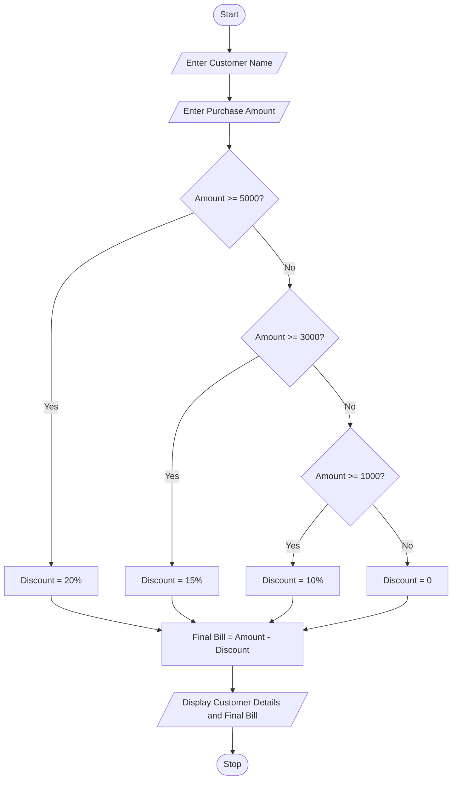

## Problem Statement
Develop a Python program to calculate the final bill amount of a customer based on their purchase amount. The program should apply different discount percentages depending on the purchase amount and display the customer name, purchase amount, discount, and final bill.

## Objectives
1. To accept customer details and purchase amount.
2. To calculate discounts based on purchase value.
3. To apply multiple discount rules using conditional statements.
4. To calculate the final bill amount.
5. To display the complete billing details.
6. To understand the practical application of Python in retail billing systems.
 
## Assumptions
1. Customer name is entered by the user.
2. Purchase amount is entered in rupees.
3. Purchases of ₹5,000 or above receive a 20% discount.
4. Purchases of ₹3,000 or above receive a 15% discount.
5. Purchases of ₹1,000 or above receive a 10% discount.
6. Purchases below ₹1,000 receive no discount.
7. Only one discount is applied to each purchase.
 
## Algorithm
1. Start the program.
2. Enter customer name.
3. Enter purchase amount.
4. Check whether the purchase amount is greater than or equal to ₹5,000.
5. If true, calculate a 20% discount.
6. Otherwise, check whether the amount is greater than or equal to ₹3,000.
7. If true, calculate a 15% discount.
8. Otherwise, check whether the amount is greater than or equal to ₹1,000.
9. If true, calculate a 10% discount.
10. Otherwise, set the discount to zero.
11. Calculate the final bill by subtracting the discount from the purchase amount.
12. Display customer details, discount, and final bill.
13. Stop the program.
 
## Pseudocode
START

INPUT customer_name
INPUT amount

IF amount >= 5000 THEN
    discount = amount * 0.20

ELSE IF amount >= 3000 THEN
    discount = amount * 0.15

ELSE IF amount >= 1000 THEN
    discount = amount * 0.10

ELSE
    discount = 0

END IF

final_bill = amount - discount

DISPLAY customer_name
DISPLAY amount
DISPLAY discount
DISPLAY final_bill

STOP

```## Test Cases
   Test Case   |  	Customer	    |      Purchase Amount      |       	Discount       |   	Final Bill
       1	      |      Ravi	     |         ₹6,000	           |      ₹1,200 (20%)	    |       ₹4,800
       2       |    	Sita	      |         ₹4,000            |      ₹600 (15%)       |      	₹3,400
       3	      |      Kumar	    |         ₹2,000	           |      ₹200 (10%)       |      	₹1,800
       4	      |      Priya	    |         ₹800	             |      ₹0	              |       ₹800
       5	      |      Rani      |       	₹5,000	            |      ₹1,000 (20%)     |     	₹4,000
```

## Output Screenshots
Enter customer name: Ravi
Enter purchase amount: 6000

--- Retail Bill ---
Customer Name: Ravi
Purchase Amount: Rs. 6000.0
Discount: Rs. 1200.0
Final Bill: Rs. 4800.0
Enter customer name: Sita
Enter purchase amount: 4000

--- Retail Bill ---
Customer Name: Sita
Purchase Amount: Rs. 4000.0
Discount: Rs. 600.0
Final Bill: Rs. 3400.0
Enter customer name: Priya
Enter purchase amount: 800

--- Retail Bill ---
Customer Name: Priya
Purchase Amount: Rs. 800.0
Discount: Rs. 0
Final Bill: Rs. 800.0

## Conclusion
The Retail Billing with Multiple Discount Rules program successfully calculates the final bill based on the customer's purchase amount. It uses Python if, elif, and else statements to apply different discount percentages. This case study helps students understand conditional statements, arithmetic operations, and the practical application of Python in retail shopping and billing systems.

## Flowchart

