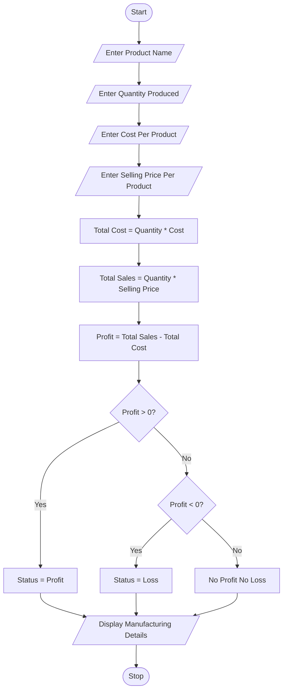

## Problem Statement
Develop a Python program to calculate the total manufacturing cost, total sales, and profit or loss of a product based on the quantity produced, cost per product, and selling price per product. The program should identify whether the business earns a profit, experiences a loss, or reaches a no-profit-no-loss situation.

## Objectives
1. To accept product details from the user.
2. To calculate the total manufacturing cost.
3. To calculate total sales revenue.
4. To calculate the profit or loss.
5. To identify the business status using conditional statements.
6. To display the manufacturing analysis clearly.
 
## Assumptions
1. Product name is entered by the user.
2. Quantity produced is entered as an integer.
3. Cost per product is entered in rupees.
4. Selling price per product is entered in rupees.
5. All products produced are sold.
6. Additional expenses such as transportation and electricity are not considered.
7. Profit is calculated by subtracting total cost from total sales.
 
## Algorithm
1. Start the program.
2. Enter product name.
3. Enter quantity produced.
4. Enter cost per product.
5. Enter selling price per product.
6. Calculate total cost (Quantity × Cost).
7. Calculate total sales (Quantity × Selling Price).
8. Calculate profit (Total Sales − Total Cost).
9. Check whether profit is greater than zero.
10. If true, display Profit.
11. Otherwise, check whether profit is less than zero.
12. If true, display Loss.
13. Otherwise, display No Profit No Loss.
14. Display all manufacturing details.
15. Stop the program.
 
## Pseudocode
START

INPUT product_name
INPUT quantity
INPUT cost
INPUT selling_price

total_cost = quantity * cost

total_sales = quantity * selling_price

profit = total_sales - total_cost

DISPLAY product_name
DISPLAY quantity
DISPLAY total_cost
DISPLAY total_sales
DISPLAY profit

IF profit > 0 THEN
    DISPLAY "Profit"

ELSE IF profit < 0 THEN
    DISPLAY "Loss"

ELSE
    DISPLAY "No Profit No Loss"

END IF

STOP

```## Test Cases
   Test Case     |     	Quantity   	  |      Cost/Product    |     Selling Price	     |       Expected Result
       1	        |        100	        |          ₹50	        |           ₹80	         |         Profit ₹3,000
       2         |       	100         |         ₹100         |           ₹80          |        	Loss ₹2,000
       3	        |         50	        |          ₹100        |           ₹100	        |       No Profit No Loss
       4	        |        200	        |          ₹20         |           ₹30          |       	Profit ₹2,000
       5         |      	10           |         ₹500	        |           ₹400	        |         Loss ₹1,000
```

## Output Screenshots
Enter product name: Bags
Enter quantity produced: 100
Enter cost per product: 50
Enter selling price per product: 80

--- Manufacturing Analysis ---
Product Name: Bags
Quantity Produced: 100
Total Cost: Rs. 5000.0
Total Sales: Rs. 8000.0
Profit: Rs. 3000.0
Status: Profit
Enter product name: Shoes
Enter quantity produced: 100
Enter cost per product: 100
Enter selling price per product: 80

--- Manufacturing Analysis ---
Product Name: Shoes
Quantity Produced: 100
Total Cost: Rs. 10000.0
Total Sales: Rs. 8000.0
Profit: Rs. -2000.0
Status: Loss
Enter product name: Books
Enter quantity produced: 50
Enter cost per product: 100
Enter selling price per product: 100

--- Manufacturing Analysis ---
Product Name: Books
Quantity Produced: 50
Total Cost: Rs. 5000.0
Total Sales: Rs. 5000.0
Profit: Rs. 0.0
Status: No Profit No Loss

## Conclusion
The Manufacturing Cost and Profitability Analysis program successfully calculates total manufacturing cost, sales revenue, and profit or loss. It uses Python arithmetic operations and conditional statements to identify the financial status of a manufacturing business. This case study helps students understand basic business calculations and the practical applications of Python in manufacturing industries.

## Flowchart

