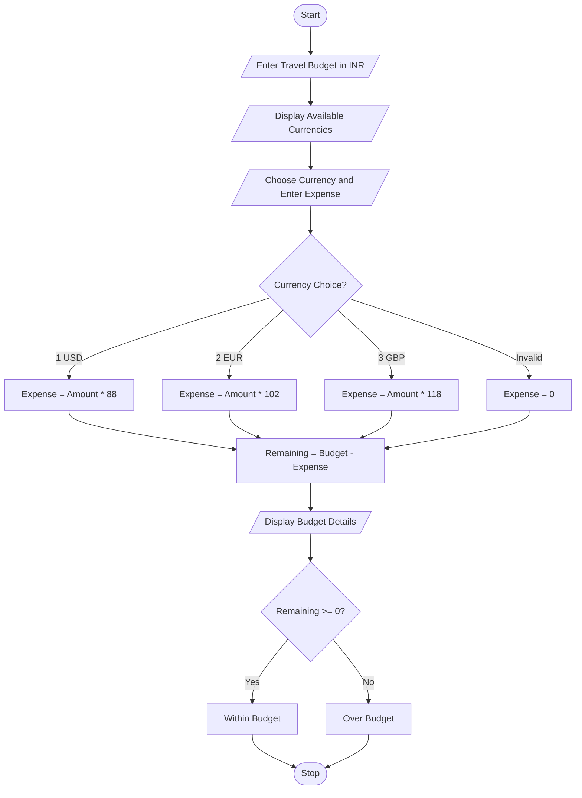

## Problem Statement
Develop a Python program to analyze a travel budget by converting foreign currency expenses into Indian Rupees (INR). The program should support US Dollar (USD), Euro (EUR), and British Pound (GBP). It should calculate the total travel expense, remaining budget, and identify whether the expenses are within budget or over budget.

## Objectives
1. To accept the travel budget in Indian Rupees.
2. To provide different foreign currency options.
3. To convert foreign currency expenses into INR.
4. To calculate the remaining travel budget.
5. To identify whether the expenses are within budget or over budget.
6. To display the complete travel budget analysis.
 
## Assumptions
1. Travel budget is entered in Indian Rupees.
2. Travel expense is entered in the selected foreign currency.
3. USD conversion rate is ₹88.
4. EUR conversion rate is ₹102.
5. GBP conversion rate is ₹118.
6. Exchange rates are fixed for this program.
7. Only one foreign currency is selected at a time.
8. A negative remaining balance indicates that the budget is exceeded.
 
## Algorithm
1. Start the program.
2. Enter the total travel budget in INR.
3. Display the available currencies.
4. Select the currency.
5. Enter the travel expense in the selected currency.
6. Check the currency choice.
7. If USD is selected, multiply the amount by 88.
8. If EUR is selected, multiply the amount by 102.
9. If GBP is selected, multiply the amount by 118.
10. Calculate the remaining budget by subtracting the expense from the total budget.
11. Display currency, travel expense, total budget, and remaining budget.
12. If the remaining budget is greater than or equal to zero, display Within Budget.
13. Otherwise, display Over Budget.
14. Stop the program.
 
## Pseudocode
START

INPUT budget

DISPLAY available currencies

INPUT choice
INPUT amount

IF choice == 1 THEN
    expense = amount * 88
    currency = "USD"

ELSE IF choice == 2 THEN
    expense = amount * 102
    currency = "EUR"

ELSE IF choice == 3 THEN
    expense = amount * 118
    currency = "GBP"

ELSE
    expense = 0
    currency = "Invalid"
END IF

remaining = budget - expense

DISPLAY currency
DISPLAY expense
DISPLAY budget
DISPLAY remaining

IF remaining >= 0 THEN
    DISPLAY "Within Budget"
ELSE
    DISPLAY "Over Budget"
END IF

STOP

```## Test Cases
  Test Case   |	   Budget	| Currency    |   	Expense |	Expected Status
      1	      |  ₹50,000	|   USD	      |      $300   | 	Within Budget
      2	      |  ₹40,000  |   EUR       |      €200	  |   Within Budget
      3	      |  ₹20,000	|   GBP	      |      £200	  |   Over Budget
      4	      |  ₹30,000	|   USD	      |      $400   | 	Over Budget
      5       |  ₹50,000  | 	EUR       |      €400	  |   Within Budget
```

## Output Screenshots
Enter travel budget in INR: 50000

1. US Dollar (USD)
2. Euro (EUR)
3. British Pound (GBP)

Choose currency: 1
Enter travel expense: 300

--- Travel Budget Analysis ---
Currency: USD
Travel Expense: Rs. 26400.0
Total Budget: Rs. 50000.0
Remaining Budget: Rs. 23600.0
Status: Within Budget
Enter travel budget in INR: 20000

1. US Dollar (USD)
2. Euro (EUR)
3. British Pound (GBP)

Choose currency: 3
Enter travel expense: 200

--- Travel Budget Analysis ---
Currency: GBP
Travel Expense: Rs. 23600.0
Total Budget: Rs. 20000.0
Remaining Budget: Rs. -3600.0
Status: Over Budget
Enter travel budget in INR: 40000

1. US Dollar (USD)
2. Euro (EUR)
3. British Pound (GBP)

Choose currency: 2
Enter travel expense: 200

--- Travel Budget Analysis ---
Currency: EUR
Travel Expense: Rs. 20400.0
Total Budget: Rs. 40000.0
Remaining Budget: Rs. 19600.0
Status: Within Budget

## Conclusion
The Multi-Currency Travel Budget Analysis program successfully converts foreign currency expenses into Indian Rupees and calculates the remaining travel budget. It uses Python conditional statements and arithmetic operations to support multiple currencies and identify whether the expenses are within budget or over budget. This case study helps students understand currency conversion, budget management, and the practical applications of Python in travel planning.

## Flowchart

